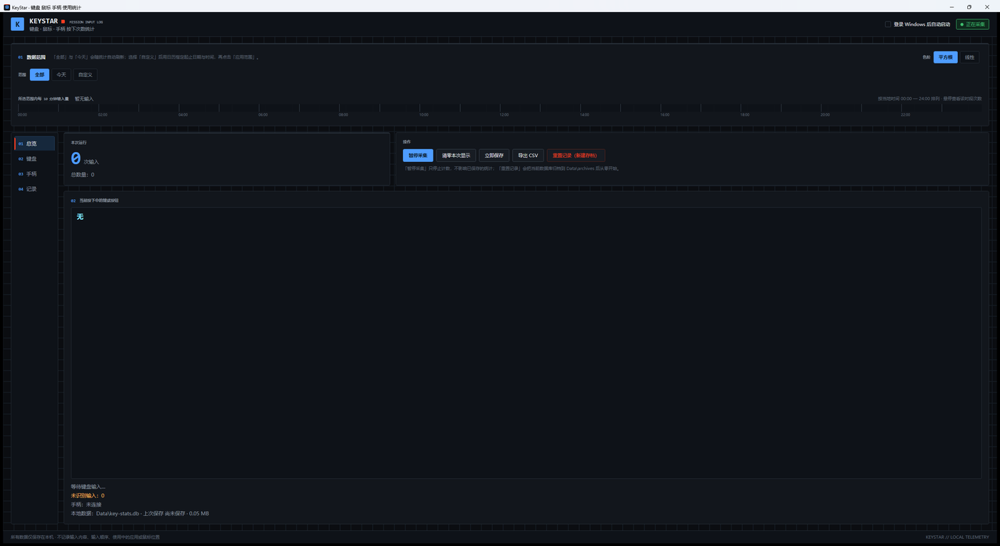
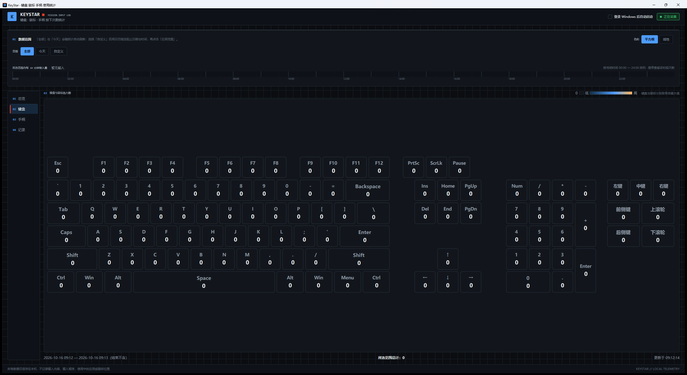
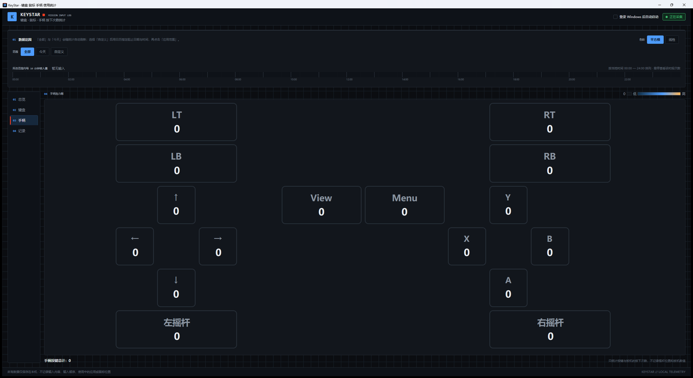
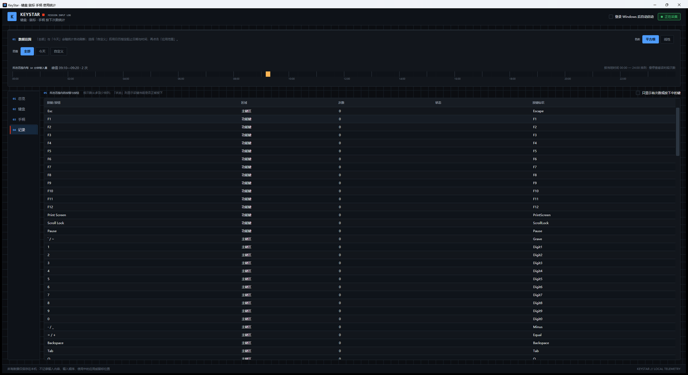

# KeyStar 使用指南

KeyStar 用于统计键盘按键、鼠标按键和滚轮、以及手柄按键的使用次数。所有数据只保存在本机，不登录、不上传，也不记录输入内容、输入顺序、使用中的应用或鼠标位置。

界面采用深色仪表盘风格：深色底、蓝图网格、等宽字体模块编号、红色仪表条与蓝色/红色点缀。

## 窗口结构

主窗口分为四部分：

1. **顶栏**：左侧是程序标识，右侧是「登录 Windows 后自动启动」开关和当前采集状态徽标；
2. **数据范围工具条**：位于顶栏下方，在任意页面都可用，用来选择统计范围、色阶方式并查看十分钟时段分布；
3. **左侧导航**：四个页面——总览、键盘、手柄、记录，点击即可切换；
4. **页脚**：隐私说明与版本标识。

### 总览

- 「本次运行」显示本次启动后累计的输入次数，下方「总数量」是数据库中的全部历史输入加上尚未自动保存的输入；
- 「操作」区按钮：
  - **暂停采集**：暂停后按钮变为「恢复采集」，已有记录不受影响；
  - **清零本次显示**：只影响本次运行，不删除历史数据；
  - **立即保存**：把当前分钟聚合立刻写入数据库；
  - **导出 CSV**：把所选范围导出为 CSV 文件；
  - **重置记录（新建存档）**：新建空存档继续统计，旧数据整份归档；
- 下方「当前按下中的键或按钮」实时显示正被按下的键，并列出最近一次输入、未识别输入数量、手柄连接状态和本地数据状态。

### 键盘

- 全尺寸键盘热力图，鼠标按键区排在键盘最右侧，按小键盘方式分三行：左键/中键/右键、前侧键/上滚轮、后侧键/下滚轮；
- 颜色越亮表示所选范围内该键按下次数越多，色阶为「深蓝 → 亮蓝 → 琥珀」；
- 键盘和鼠标分别按各自的最大值着色，避免滚轮次数过多时键盘色阶被压到最浅；
- 鼠标悬停在键帽上会显示按键名称、次数、占全部输入的百分比和排名。

### 手柄

- 手柄按键单独显示在手柄热力图页面，按照手柄实际形状排列，不与键盘混排；
- 手柄统计包含：
  - A、B、X、Y 四个动作键；
  - LB、RB 肩键和 LT、RT 扳机（扳机按阈值判定为一次按下，按住不会连发）；
  - View、Menu 功能键；
  - 左、右摇杆按下（L3/R3）；
  - 十字键上、下、左、右；
- 手柄按键按通用布局命名：Xbox 手柄可直接使用，工作在 XInput 兼容模式下的其他手柄（多数国产手柄、Steam 输入下的 DualSense 等）同样可以统计。最多同时统计 4 个手柄，各手柄分别计数。

### 记录

- 所选范围内的按键明细列表，按次数从多到少排列；
- 列包含按键名称、区域、次数、当前是否按下、按键标识；
- 勾选「只显示有次数或按下中的键」可以隐藏次数为 0 的键。

## 数据范围与时段分布

- 范围有三个选项，默认选中「全部」：
  - **全部**：从数据库最早一条记录到当前时刻，适合看长期累计情况；
  - **今天**：当天 00:00 到当前时刻，会随时间自动刷新；
  - **自定义**：自己指定起止时间——用日历选日期，再直接输入 `HH:mm` 时间（精确到分钟），点击「应用范围」生效。切回「自定义」会保留上一次确认过的区间；
- 时段分布按一天中的 144 个十分钟时段汇总，鼠标停在时段上约 0.5 秒后会显示具体时间段和输入次数；
- 时段分布上方的摘要会标出峰值时段；
- 切换范围后，热力图、时段分布和记录列表同步更新；
- 「色阶」可选平方根和线性两个按钮：平方根会让低频按键更容易看清，线性更接近真实比例。

## 基本使用

- 运行 `KeyStar.exe` 后即可开始采集；
- 关闭主窗口后程序会继续在系统托盘运行；
- 双击托盘图标可以重新打开统计窗口；
- 需要停止采集时，请从托盘菜单选择「完整退出」；
- 调整窗口大小和位置后会被记住，下次启动自动恢复；如果换了显示器或分辨率导致原位置不可用，会退回默认大小并居中。

## 键盘布局与按键识别

- 数字键盘在 NumLock 关闭时按导航功能记录：小键盘 7/1/9/3 计入 Home/End/Page Up/Page Down，0 与 . 计入 Insert/Delete，8/2/4/6 计入上下左右方向键；NumLock 打开时仍然计入数字键盘数字；
- 因此 98 配列等「Home/End 与小键盘共用、用 NumLock 切换」的键盘也能正确统计 Home/End；
- 主键区的导航键（带 E0 标志）与数字键盘上的同功能按键合并统计，热力图上显示在导航键位置。

## 重置记录与存档

- 点击「重置记录（新建存档）」并确认后，当前数据库会整份移动到 `Data\archives\key-stats-<时间>.db`，界面会提示具体路径；
- 程序随即新建空的 `key-stats.db`，从 0 开始记录，「本次运行」和「总数量」重新计算；
- 存档文件名带时间戳，同一秒内多次重置会自动追加序号，不会覆盖已有存档；
- 需要回看某份存档时，先完整退出程序，把该存档文件**复制**一份改名为 `Data\key-stats.db` 再启动即可（建议保留原存档文件）。

## 数据保存与迁移

- 数据保存在程序旁的 `Data` 目录；
- 完整移动程序文件夹即可迁移数据；
- 完整版与轻量版的数据格式相同，可以直接复制整个 `Data` 目录；
- 如果移动前启用了登录自动启动，请在新位置运行程序后，取消并重新勾选一次，以更新启动路径。

## 两种版本

- 完整版：内含 .NET 10 桌面运行时，无需安装其他环境；
- 轻量版：文件更小，需要电脑已安装 x64 `.NET 10 Desktop Runtime`。

## 游戏兼容性

如果游戏以管理员权限运行，请先从托盘完整退出 KeyStar，再尝试以管理员身份启动 KeyStar。部分采用独占输入或反作弊隔离的游戏可能不会向普通桌面程序提供输入事件。
